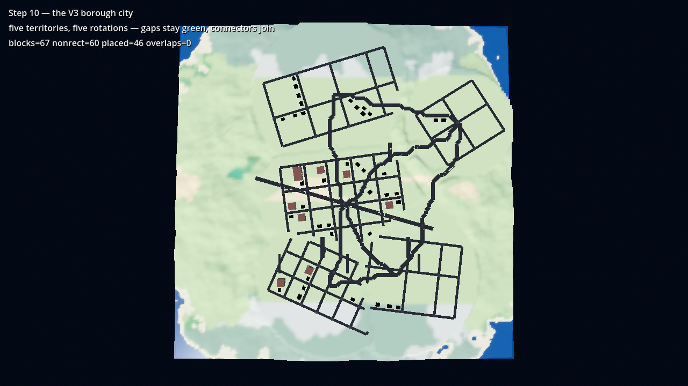
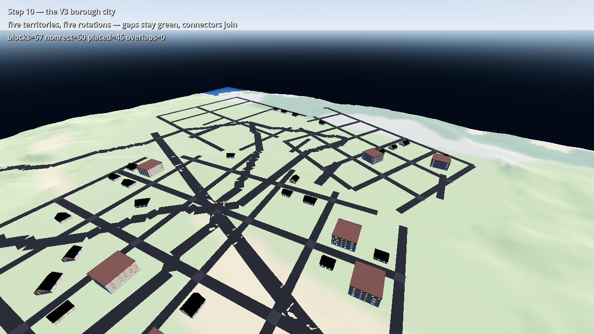
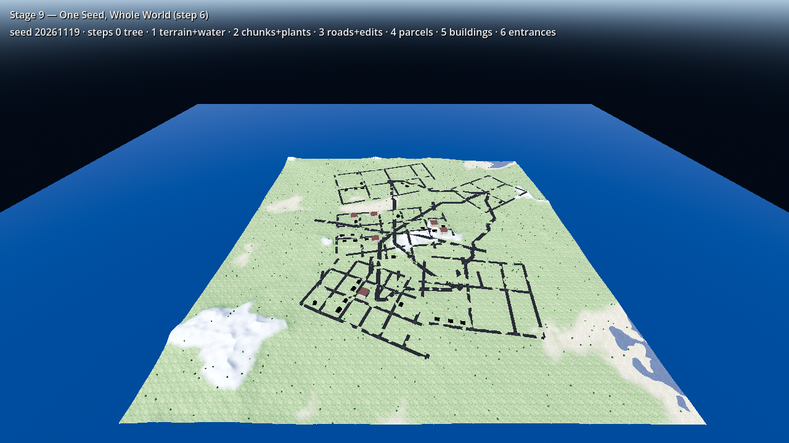
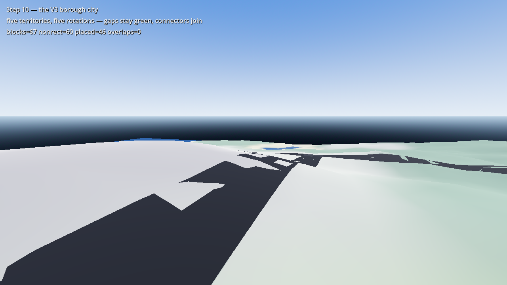
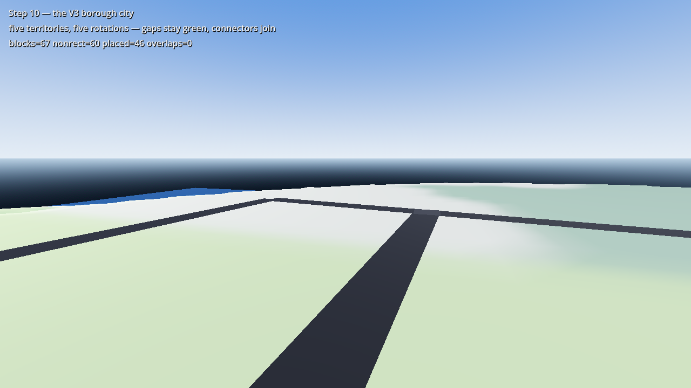

# ProcGenBook — companion project for "Procedural Generation in Godot — The Complete Guide"

- **Master seed:** 20261119 (book seed; the masterclass course used 20261116)
- **Engine:** Godot 4.7.2, Forward+
- **Layout mirrors the course's ProcGenWorld** so book, course, and project agree (PLAN.md §5).

## Gallery — renders from the book

*The step-10 city from above (Chapter 41): five boroughs on separate territories, joined by connector roads — nothing overlaps.*

*A borough boundary from the air: one grid ends, a green gap, then the neighbour's rotated grid begins.*

*The capstone world (Chapter 43): every generator in the book composed into one seed-grown world.*

## About this repository's history - please read first

This repository's git history is **organized by book part** so readers can
follow along with the book: each commit adds the project's files as they
stand at the end of one part, in the book's order (Part 0 Foundations
through Part IX Integration & Shipping). Check out any part's commit to see
the project as it stands at the end of that part.

Plainly stated: **this history was reconstructed and organized by book part
for publication. It is a reader-organized history of the book's final code -
it is not a literal record of the order in which the code was originally
developed.** The code in every commit is the final version used in the book
(master seed 20261119); no earlier drafts or intermediate versions are
preserved here.

The book itself - *Procedural Generation in Godot - The Complete Guide* by
Zachary Shade - is the source of truth for what each part builds and why.
This project is its companion: same seed, same code, same world.

## Licence

MIT - see `LICENSE`. The Kenney furniture models under `assets/` are CC0
(Kenney, kenney.nl).

One formatting note: `terrain/data/montreal_roads.json` (the raw OpenStreetMap
Overpass export used in Chapter 8) is stored **minified** in this repository -
same data, whitespace removed - because the pretty-printed export exceeds
GitHub's 100 MB file-size limit. The book's importer parses JSON, so it reads
identically.

## Layout
- `core/` — SeedBank + WorldConfig (knows nothing about domains)
- `terrain/`, `plants/`, `dungeon/`, `houses/`, `apartments/`, `offices/`, `city/` — one folder per domain; a stage's generator/builder script lives in its domain folder
- `capstone/` — the full one-seed pipeline
- `stages/` — stage scenes (`stage_<part>_<slug>.tscn`) + `stage_base.gd` + the stage pattern in `stages/README.md`
- `tools/` — the capture harness (`book_capture`) and X11 editor-capture helpers
- `addons/book_stage/` — EditorPlugin that arranges a stage in the editor for ENGINE screenshots
- `captures/` — default output folder for local captures (book images are copied to the book repo after verification)

## City grading — the ground answers back (Chapter 42, §42.3)

Cities are graded before their roads are drawn: `city/terrain_grader.gd`
blends each borough's territory toward one reference height and benches
every road corridor to a smoothed profile, so streets sit on level ground
instead of draping raw terrain. The pair below is the book's own
before/after — step 10, street road 31:

*Before grading: the terrain poked through the road ribbon on road 31 (step 10).*

*After grading: the same crossing sits on one level bench.*

## Book rule
Every generator draws randomness ONLY from its own named SeedBank stream.
No global `randf()` / `randi()` in generator code. Same seed, same world.
